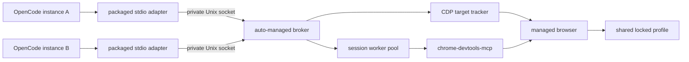

# Browser MCP

[](https://www.npmjs.com/package/@mirsella/browser-mcp)
[](https://github.com/mirsella/browser-mcp/actions/workflows/ci.yml)
[](LICENSE)

One shared browser profile with separate tab ownership for OpenCode sessions
and Codex conversations. The plugin wraps
[`chrome-devtools-mcp`](https://github.com/ChromeDevTools/chrome-devtools-mcp)
and routes each conversation through its own browser tabs while sharing cookies,
logins, local storage, cache, and extensions.

Package 2.x targets OpenCode v2 (2.0.27 or newer). Package 1.x retains the
OpenCode v1 adapter (1.18 or newer, below 2). Codex uses the same Rust MCP
server and manifests in both releases. The native v2 adapter uses
`@opencode/plugin`; local directories also expose a physical `server` entrypoint.

Install `@mirsella/browser-mcp` for OpenCode v2, or `@mirsella/browser-mcp@opencode1`
for OpenCode v1. Existing Nix-managed and local-directory installations can keep
their configured paths.

## Requirements

- OpenCode 2.0.27 or newer, or Codex with plugin and hook support
- Linux x64
- Bun
- A local Chromium-family browser
- A graphical session, unless `OPENCODE_BROWSER_HEADLESS=true`

## OpenCode setup

Add the plugin to `opencode.json`. It enables the browser server and makes
the browser automation skill available by default:

```json
{
  "$schema": "https://opencode.ai/v2/config.json",
  "plugins": ["@mirsella/browser-mcp"]
}
```

Restart OpenCode after changing its configuration. That is the complete setup.
You do not need a separate installation, broker command, or background service.

The first adapter starts the packaged native broker automatically.
Concurrent Codex and OpenCode instances converge on the same private socket and browser
profile. The broker remains available while at least one adapter is connected,
then closes the browser and exits shortly after the final adapter disconnects.

The CDP port defaults to `9222`. If that port is occupied, the broker logs the
collision and selects a free loopback port without adopting or stopping the
other listener. Adapters keep the same configuration and share the selected
endpoint. A replacement broker reuses that port only when the exact persisted
browser generation is still running.

OpenCode loads the JavaScript `./server` package export. Codex uses the
plugin and MCP manifests plus the session hooks. Both integrations launch
the same packaged Rust executable.

## Timeouts and diagnostics

Each browser action has one deadline for catalog discovery, browser startup,
session locking, execution, and reconciliation. `OPENCODE_BROWSER_OPERATION_SECONDS`
sets that deadline and defaults to 540 seconds. Catalog discovery and compact
help have a separate 70-second limit. A failed or panicking catalog discovery
can be retried without restarting the broker.

After an interrupted action, the next call replaces that session's worker and
reconciles its existing owned tabs. Actions are never replayed automatically.
Dispatched tab creation finishes registering ownership or closing that exact
target after caller cancellation. Inspect the page before retrying a write
because it may already have taken effect.

The broker writes diagnostics to
`$XDG_STATE_HOME/browser-mcp/broker-<profile-hash>.log`, or
`~/.local/state/browser-mcp/` when `XDG_STATE_HOME` is unset. Its startup message
prints the exact path. Logs are readable only by your user and also go to stderr.

Request tracing records the tool name, session ID, current stage, and elapsed
time. It does not record tool arguments. If a call stalls, look for its last
stage and whether the broker recorded a deadline, cancellation, catalog failure,
or worker replacement. Browser stderr is captured in
`browser-<profile-hash>.log` in the same directory. Its separate writer survives
broker replacement and exits when Chromium closes the pipe. Each broker or
browser log retains an 8 MiB file and one rotated `.log.1` backup. A browser that
exits during startup reports that exit immediately.

## Codex setup

The release tarball contains the executable, both integrations, and a local
Codex marketplace. Download it from [GitHub Releases](https://github.com/mirsella/browser-mcp/releases),
extract it to a permanent directory, then register that directory:

```sh
codex plugin marketplace add /path/to/browser-mcp
codex plugin add browser@browser-mcp
```

The npm package is now `@mirsella/browser-mcp`; it replaces `@mirsella/opencode-browser-mcp`.
To use a GitHub release in OpenCode, set the plugin entry to the `file:///absolute/path`
of its unpacked directory instead of the npm name.

For a source checkout, build and stage the binary first (`bun run build:native`
and `bun run stage:native`). Use a packaged directory for installation so
compiler outputs are not copied into Codex's plugin cache.

The installed plugin is enabled by default. Open `/hooks` in Codex to review
and trust its two hooks, then restart Codex. They inject the conversation ID
before browser calls and release owned tabs at `SessionEnd`. Browser calls
without an injected identity fail closed. The plugin exposes compact `help`
and `dispatch` tools and loads the same browser automation skill as OpenCode.

Codex and OpenCode use separate ownership namespaces while sharing the existing
broker, profile, cookies and logins. Codex's hook API identifies subagents with
their parent conversation ID, so subagents share that conversation's tabs.
Use separate pages when they work concurrently.

Codex runs `SessionEnd` on normal shutdown, on archive/delete of an open
conversation, or after 30 minutes idle with no client connected. Its hook has
a three-second deadline: the broker acknowledges cleanup promptly, then waits
for active calls before closing only that conversation's owned tabs. Cleanup
does not start a broker when none is running. Crashes still use normal broker
shutdown and idle cleanup.

The Codex MCP entry uses a 540-second tool timeout. Add `--direct-tools` to its
arguments when configuring per-action Codex tool approval rules; compact
dispatch has one approval rule for all actions.

## Plugin behavior

The plugin:

- registers and enables the packaged browser MCP adapter;
- injects the active OpenCode session ID after model argument generation;
- exposes compact browser tools unless existing permissions require direct tools;
- releases owned tabs when an OpenCode session is deleted;
- registers the bundled browser automation skill when the server is enabled.

OpenCode sees two compact tools by default:

- `browser_dispatch` executes one browser action.
- `browser_help` lists actions or loads one action schema.

If the plugin detects per-action `browser_*` permission or tool rules, it uses
direct tools so those policies continue to work.

Settings:

- `enabled` (default `true`): start the server and load the skill. Set it to
  `false` to disable both. An explicit `mcp.servers.browser` entry takes precedence.
- `compactTools` (default `true`): keep `browser_dispatch` and `browser_help`
  instead of the direct tools. Set it to `false` to always use direct tools:

```json
{
  "$schema": "https://opencode.ai/v2/config.json",
  "plugins": [
    { "package": "@mirsella/browser-mcp", "options": { "compactTools": false } }
  ]
}
```

## Architecture



The adapter starts the broker on demand but does not own it. This lets adapters
from separate OpenCode processes share one browser without tying its lifetime to
whichever process connected first. Socket and profile locks make simultaneous
startup race-safe and prevent two browsers from opening the same profile.

Each routed session leases its own `chrome-devtools-mcp` worker. Stable
browser-level CDP target IDs remain the ownership authority; worker-local page
numbers are removed from model-visible schemas and responses.

## Ownership guarantees

- A tab has at most one owner.
- Routed sessions execute concurrently through separate workers.
- Popups inherit the owner of their opener tab.
- A session cannot select, inspect, or close another session's tabs through the broker.
- Manual and otherwise unowned tabs are not claimed during cleanup.
- Ownership conflicts, stale browser generations, and malformed responses fail closed.

These are routing guarantees, not an operating-system security boundary. Any
process running as the same Unix user can connect directly to the browser's
loopback CDP port.

## Browser and profile

The plugin detects Chromium, Google Chrome, Helium, Brave, and Microsoft Edge.
Chromium is preferred by default; `OPENCODE_BROWSER_EXECUTABLE` overrides
automatic detection.
Google Chrome 136 and newer ignore remote-debugging flags for its default data
directory, so Chrome uses a dedicated directory under
`~/.config/opencode-browser-mcp` by default. Other detected browsers retain their
existing profile defaults.

The broker starts Chromium lazily on the first browser action. For a headed
browser it passes only a fixed allowlist of display and desktop variables. The
current process environment stays authoritative; missing values are recovered
from the current user session when available.

Configuration variables inherited from either host (the existing names are
shared by both integrations):

| Variable | Default | Purpose |
| --- | --- | --- |
| `OPENCODE_BROWSER_EXECUTABLE` | auto-detected | Chromium-family executable |
| `OPENCODE_BROWSER_PROFILE` | browser-dependent | Shared browser data directory |
| `OPENCODE_BROWSER_HEADLESS` | `false` | Run without a visible window |
| `OPENCODE_BROWSER_SESSION_LAYOUT` | `shared-window` | `shared-window` or `window-per-session` |
| `OPENCODE_BROWSER_CDP_PORT` | `9222` | Preferred loopback CDP port; a free port is selected on collision |
| `OPENCODE_BROWSER_IDLE_MINUTES` | `30` | Fallback cleanup for routed sessions |
| `OPENCODE_BROWSER_MAX_PAGES` | `5` | Max owned tabs per agent session |
| `OPENCODE_BROWSER_STARTUP_SECONDS` | `20` | Browser startup deadline |
| `OPENCODE_BROWSER_OPERATION_SECONDS` | `540` | Browser operation deadline |
| `OPENCODE_BROWSER_DOWNSTREAM_COMMAND` | `bunx` | DevTools MCP launcher |

## Lifecycle

| Event | Behavior |
| --- | --- |
| First adapter connects | One internal broker acquires the socket and profile leases |
| Tools are listed | Chromium remains stopped |
| First browser action | Chromium and the ownership tracker start |
| OpenCode turn becomes idle | Owned tabs remain available for the next turn |
| OpenCode session is deleted | Only that session's owned tabs close |
| Each session owns at most 5 pages | `new_page` beyond the cap fails; reuse a page with `navigate_page` or free one with `close_page` |
| Routed session reaches the configured inactivity timeout | Fallback cleanup closes that session's owned tabs; defaults to 30 minutes and `0` disables it |
| Another OpenCode instance connects | It shares the broker and profile with isolated tab ownership |
| Final adapter disconnects | The broker waits briefly, closes Chromium, and exits |
| Browser exits, segfaults, or is killed | The next browser action starts Chromium again; ownership from the old browser generation is discarded |
| DevTools worker exits or loses its transport | The next call replaces the worker and restores routing to surviving owned tabs |
| Broker exits unexpectedly | Connected adapters stay available and start one replacement on the next call; surviving tabs are restored only when the exact browser generation matches |
| MCP adapter exits unexpectedly | The OpenCode plugin reconnects it automatically, with retries up to 30 seconds apart |

Calls interrupted after dispatch can have taken effect. They return an error and
are never replayed automatically. Inspect the browser state before retrying an
action. Explicitly disabled or disconnected MCP entries stay disabled.

## Troubleshooting

- A headed startup error mentioning `DISPLAY` or `WAYLAND_DISPLAY` means no graphical session could be found. Set `OPENCODE_BROWSER_HEADLESS=true` when running without one.
- A profile or socket lease error means another live package process owns it or a stale process is still running. Do not bypass the locks.
- A process on the configured CDP port must belong to the exact managed browser generation. Stop it or choose another port.
- If downstream startup fails, verify that `bunx` is available to OpenCode.
- The plugin refuses to replace an unrelated `mcp.servers.browser` entry.

## Security

All sessions deliberately share cookies, authentication, storage, extensions,
permissions, history, and downloads. Browser content remains untrusted and may
contain prompt injection. The private same-UID socket prevents access by other
local users, but it does not isolate processes already running as your Unix user.

File exports can use the conversation's workspace and `/tmp/opencode`.
Chrome DevTools also permits its OS temporary directory. `/tmp/opencode`
is a shared scratch directory for small, temporary snapshots,
screenshots, and network responses. Clean up exported files when finished;
store larger or lasting artifacts in the workspace.

Read [`SECURITY.md`](SECURITY.md) before using a profile with sensitive data.

## Development

```sh
cargo fmt --check
cargo test --all-targets
cargo clippy --all-targets -- -D warnings
bun test tests/plugin.test.ts
cargo test --release --test e2e -- --ignored --nocapture --test-threads=1
```

The headed E2E starts adapters against temporary profiles, sockets, and CDP
ports. It checks automatic startup, startup races, cookie sharing, tab isolation,
concurrent calls, active-call cleanup, reconnect grace, compact
dispatch, both window layouts, and automatic browser shutdown.

| Path | Responsibility |
| --- | --- |
| `plugin/` | OpenCode registration, session routing, and cleanup controls |
| `vendor/` | packaged native binary used directly by the OpenCode plugin |
| `src/broker.rs` | adapter bridge, managed broker lifecycle, routing, and leases |
| `src/cdp.rs` | stable CDP target tracking and ownership |
| `src/main.rs` | browser supervision, workers, and response filtering |
| `src/persistence.rs` | atomic generation-scoped ownership state |
| `tests/e2e.rs` | startup, shared-profile, isolation, routing, and shutdown coverage |

See [`CONTRIBUTING.md`](CONTRIBUTING.md) for the development and release workflow.

## Releases

CI builds and tests the distributable tarball on every push. Run the `release`
workflow from `main` with the full tested source commit: `main` for 2.x, or
`release/opencode-v1` for 1.x. The workflow verifies that commit and downloads
its checksummed CI artifact instead of rebuilding it. Dispatch with
`npm_mode=publish` to publish through npm's OIDC trusted publisher, create the
GitHub release, and update the Codex marketplace branch for `latest`. Use
`npm_mode=dry-run` to verify without writing. The channels are `latest` for 2.x
and `opencode1` for 1.x.

## License

[MIT](LICENSE)
