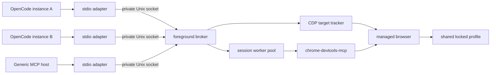

# opencode-browser-mcp

[](https://www.npmjs.com/package/@mirsella/opencode-browser-mcp)
[](https://github.com/mirsella/opencode-browser-mcp/actions/workflows/ci.yml)
[](LICENSE)

**One shared browser profile. Separate tab ownership for every MCP session.**

This package is a local browser broker built around
[`chrome-devtools-mcp`](https://github.com/ChromeDevTools/chrome-devtools-mcp).
One explicit broker process owns the Chromium-family browser, profile, CDP
connection, workers, and tab ownership state. OpenCode instances and generic MCP
hosts connect through small stdio adapters over a private Unix socket.

All adapters share cookies, logins, local storage, cache, extensions, and other
profile data. They do not share tab control: the broker assigns each CDP tab to
one routed session and filters every action and response by that ownership.

The broker is never started implicitly. Its launch environment and browser
configuration are explicit, so an unrelated OpenCode service cannot accidentally
start Chromium with stale display variables. The broker stays alive when all
adapters disconnect and stops only on a signal or an explicit control request.

## Why this exists

| Setup | Result |
| --- | --- |
| One unmodified DevTools MCP worker shared by every agent | Agents collide through shared current-page state |
| One browser per conversation or OpenCode instance | Clean isolation, but duplicated browsers, profiles, and logins |
| This project | One shared browser and profile, with exact tab ownership per routed session |

The broker does not infer ownership from the selected page. It creates tabs
through CDP, records stable target IDs, and uses that record for routing and
cleanup.

## Requirements

- Linux x64
- Bun for the default `chrome-devtools-mcp` worker launcher
- Node.js 20.19+, 22.12+, or 23+ when running through npm
- A compatible local Chromium-family browser
- A graphical display server, unless the broker runs headless
- `XDG_RUNTIME_DIR`, or an explicit socket inside a user-private directory
- An MCP host, or OpenCode 1.18+ for the bundled plugin

## Installation

The npm package includes the OpenCode plugin, browser skill, JavaScript launcher,
and Linux x64 native binary:

```sh
npm install --global @mirsella/opencode-browser-mcp
opencode-browser-mcp --help
```

The crate is not currently published on crates.io. Install the native binary
from GitHub if the OpenCode plugin is not needed:

```sh
cargo install --git https://github.com/mirsella/opencode-browser-mcp.git --locked opencode-browser-mcp
```

Build a source checkout:

```sh
git clone https://github.com/mirsella/opencode-browser-mcp.git
cd opencode-browser-mcp
bun install
cargo build --release
./target/release/opencode-browser-mcp --help
```

## Start The Broker

Start one broker before starting OpenCode or another MCP host:

```sh
opencode-browser-mcp broker
```

This is a foreground process. Run it in a terminal while testing, or supervise it
with your user service manager for regular use. Browser options belong after the
`broker` subcommand:

```sh
opencode-browser-mcp broker \
  --profile "$HOME/.config/opencode-browser-mcp/chromium" \
  --session-layout window-per-session
```

The default socket is
`$XDG_RUNTIME_DIR/opencode-browser-mcp/broker.sock`. To use another path, pass
the same global option to the broker and every adapter:

```sh
opencode-browser-mcp --socket "$XDG_RUNTIME_DIR/my-browser/broker.sock" broker
```

The custom socket's parent directory must already exist, belong to the current
user, and deny access to group and other users.

Stop the broker cleanly from another terminal:

```sh
opencode-browser-mcp stop-broker
```

### systemd user service

A user service keeps the browser available across separate OpenCode processes.
Use an absolute executable path in
`~/.config/systemd/user/opencode-browser-mcp.service`:

```ini
[Unit]
Description=Shared browser MCP broker
After=graphical-session.target
PartOf=graphical-session.target

[Service]
Type=simple
ExecStart=%h/.local/bin/opencode-browser-mcp broker
Restart=on-failure
RestartSec=2

[Install]
WantedBy=graphical-session.target
```

Before starting a headed broker, make sure the user manager has the current
graphical-session environment:

```sh
systemctl --user import-environment DISPLAY WAYLAND_DISPLAY XAUTHORITY XDG_SESSION_TYPE XDG_CURRENT_DESKTOP
systemctl --user daemon-reload
systemctl --user enable --now opencode-browser-mcp.service
```

Set broker environment variables in the unit or an `EnvironmentFile` when
needed. Restart the broker after changing browser settings. Adapters cannot
override those settings.

## OpenCode Setup

Add the package to `opencode.json` after the broker is running:

```json
{
  "$schema": "https://opencode.ai/config.json",
  "plugin": ["@mirsella/opencode-browser-mcp"]
}
```

Restart OpenCode after changing its configuration. The plugin:

- registers a local stdio adapter that connects to the existing broker;
- injects the active OpenCode session ID after model argument generation;
- exposes compact browser tools unless existing permissions require direct tools;
- releases owned tabs when an OpenCode session becomes idle or is deleted;
- registers the bundled browser automation skill.

It never starts or configures the broker.

### Compact tools

OpenCode sees two small browser tool definitions by default:

- `browser_dispatch` executes one browser action.
- `browser_help` lists actions or loads one action schema.

The complete Chrome DevTools schemas stay out of ordinary turns. If the plugin
detects per-action `browser_*` permission or tool rules, it automatically uses
direct tools so those policies keep working. Compact mode can also be disabled:

```json
{
  "$schema": "https://opencode.ai/config.json",
  "plugin": [
    ["@mirsella/opencode-browser-mcp", { "compactTools": false }]
  ]
}
```

`releaseOnIdle` defaults to `true`. Set it to `false` to keep tabs between idle
turns; deleting the OpenCode session still releases them:

```json
{
  "$schema": "https://opencode.ai/config.json",
  "plugin": [
    ["@mirsella/opencode-browser-mcp", { "releaseOnIdle": false }]
  ]
}
```

For a custom broker socket, configure the same path in the plugin:

```json
{
  "$schema": "https://opencode.ai/config.json",
  "plugin": [
    ["@mirsella/opencode-browser-mcp", { "socket": "/run/user/1000/my-browser/broker.sock" }]
  ]
}
```

Browser profile, headless mode, CDP port, timeouts, and window layout are broker
settings, not plugin settings.

### Concurrent OpenCode instances

Every OpenCode instance may use the same plugin configuration and broker socket.
Each gets an independent adapter connection, while OpenCode conversation IDs
remain the tab-ownership keys. Cookies and other profile data are shared across
all instances.

Reusing one live OpenCode session ID from two workspaces is rejected. This
prevents unrelated clients from silently taking control of the same owned tabs.

## Generic MCP Setup

The default command is a standard stdio MCP adapter in generic routing mode:

```sh
opencode-browser-mcp
```

For JSON-based MCP hosts:

```json
{
  "mcpServers": {
    "browser": {
      "command": "opencode-browser-mcp"
    }
  }
}
```

The broker must already be running. If its socket is unavailable, the adapter
fails with a clear error and does not start a background process.

Each generic adapter connection receives one unique browser session. Disconnecting
it closes only its owned tabs; the broker, browser, profile, and other adapters
remain alive. Generic clients must not set `__opencode_session_id`, which is
reserved for OpenCode routing.

## Architecture



Adapters only relay MCP bytes and identify their routing mode. The broker is the
single authority for browser configuration and profile ownership. Socket peers
must have the same Unix UID as the broker.

Each active browser session leases its own `chrome-devtools-mcp` worker. Reusable
workers are kept in a bounded, workspace-keyed warm pool and health-checked
before each lease. Compact tool listing is available before the downstream
worker starts. Direct tool listing and compact help load the catalog lazily;
neither operation opens Chromium.

Worker-local numeric page IDs never cross session boundaries. The broker maps
them to stable browser-level CDP targets and removes page selection tools from
the public surface.

Ownership state is written atomically inside the browser profile. If the broker
crashes while its browser survives, a replacement broker restores ownership only
when the exact browser WebSocket generation and live targets still match.

## Ownership Guarantees

- A tab has at most one owner.
- Routed sessions execute concurrently through separate workers.
- Popups inherit the owner of their opener tab.
- A session cannot select, inspect, or close another session's tabs through the broker.
- Manual and otherwise unowned tabs are never claimed during cleanup.
- Stale generations, malformed responses, ownership conflicts, and tracker disconnects fail closed.
- Worker page IDs, page-selection tools, and the OpenCode routing field are hidden from models.
- Per-session windows are visual organization only; stable target ownership remains authoritative.

These are routing guarantees, not an operating-system security boundary. A local
process that connects directly to the CDP port bypasses the broker.

## Browser Compatibility

The managed browser must provide a Chrome-compatible browser-level CDP endpoint.
Google Chrome and Chrome for Testing are supported by the pinned
`chrome-devtools-mcp@1.6.0`. Helium, Chromium, Brave, and Microsoft Edge are
detected on a best-effort basis.

The profile is a full user-data directory, not a named profile such as
`Default`. Chrome 136 and newer ignore remote-debugging flags for Chrome's
default data directory. For Google Chrome and Chrome for Testing, this package
therefore defaults to
`$XDG_CONFIG_HOME/opencode-browser-mcp/google-chrome`, or
`~/.config/opencode-browser-mcp/google-chrome` when `XDG_CONFIG_HOME` is unset.
Set `OPENCODE_BROWSER_PROFILE` on the broker to use another non-default profile.
Attaching to arbitrary existing or remote CDP endpoints is not supported.

## Lifecycle

| Event | Behavior |
| --- | --- |
| Broker starts | Profile and socket leases are acquired; Chromium remains stopped |
| Adapter initializes or compact tools are listed | No downstream worker or browser is started |
| Direct tools are listed or compact help is loaded | The downstream catalog starts lazily; Chromium stays stopped |
| First browser action | The managed browser and ownership tracker start |
| Generic adapter disconnects | Only that adapter's session and tabs are released |
| OpenCode session becomes idle or is deleted | The plugin asks the broker to release that session |
| All adapters disconnect | The broker and browser remain available |
| Broker receives a stop request or signal | Active calls get up to five seconds to finish, then workers and browser close and leases are released |
| Broker crashes but browser survives | Matching generation state can be recovered conservatively |

The native idle timeout is a fallback for routed sessions and defaults to 60
minutes. Set `OPENCODE_BROWSER_IDLE_MINUTES=0` on the broker to disable expiry.

## Configuration

Global adapter and control configuration:

| Environment variable | Default | Purpose |
| --- | --- | --- |
| `OPENCODE_BROWSER_SOCKET` | `$XDG_RUNTIME_DIR/opencode-browser-mcp/broker.sock` | Private broker socket used by all processes |
| `RUST_LOG` | `opencode_browser_mcp=info` | Native process log filter |

Broker-only configuration:

| Environment variable | Default | Purpose |
| --- | --- | --- |
| `OPENCODE_BROWSER_EXECUTABLE` | auto-detected | Chromium-family browser executable |
| `OPENCODE_BROWSER_PROFILE` | browser-dependent | Shared browser data directory, exclusively locked by the broker |
| `OPENCODE_BROWSER_HEADLESS` | `false` | Run Chromium without a visible window |
| `OPENCODE_BROWSER_SESSION_LAYOUT` | `shared-window` | `shared-window` or best-effort `window-per-session` |
| `OPENCODE_BROWSER_CDP_HOST` | `127.0.0.1` | CDP host; loopback only |
| `OPENCODE_BROWSER_CDP_PORT` | `9222` | CDP port |
| `OPENCODE_BROWSER_IDLE_MINUTES` | `60` | Routed-session cleanup; `0` disables expiry |
| `OPENCODE_BROWSER_STARTUP_SECONDS` | `20` | Browser startup deadline |
| `OPENCODE_BROWSER_OPERATION_SECONDS` | `540` | Browser operation deadline |
| `OPENCODE_BROWSER_DOWNSTREAM_COMMAND` | `bunx` | `chrome-devtools-mcp` launcher |
| `OPENCODE_BROWSER_DISABLE_CRASH_REPORTER` | `false` | Disable Chromium crash reporting |

The broker reads browser settings once at startup. Adapter environments do not
change a running broker.

The profile and socket directories must be owned by the current user and deny
group/other access. Runtime files are:

```text
$XDG_RUNTIME_DIR/opencode-browser-mcp/broker.sock
$XDG_RUNTIME_DIR/opencode-browser-mcp/broker.sock.lock
<profile>/opencode-browser-mcp.lock
<profile>/opencode-browser-mcp.state.json
```

The routing modes are `connection` for generic adapters, `opencode` for compact
OpenCode tools, and `opencode-direct` for OpenCode with direct tools. The plugin
selects its OpenCode mode automatically.

### Troubleshooting

- “Browser broker is not running” means the adapter could not connect. Start the foreground broker or its user service and verify that both use the same socket.
- A headed browser that reports a missing display means the broker service lacks the graphical-session environment. Import it into the user manager and restart the broker service.
- A socket or profile lease error means another broker already owns it, or a stale process is still running. Do not bypass the locks.
- A permission error means a socket/profile directory or runtime file is not private and owned by the current user.
- A process on the configured CDP port must belong to the exact managed browser generation. Stop it or choose another port.
- Broker and browser diagnostics are written to the broker's stderr or service journal. Adapter connection errors appear in the MCP host logs.
- If downstream startup fails, verify `bunx` or configure `OPENCODE_BROWSER_DOWNSTREAM_COMMAND` on the broker.
- The plugin refuses to replace an unrelated `mcp.browser` entry.

## Security Model

| Protected by the broker | Shared by design | Outside the boundary |
| --- | --- | --- |
| Tab visibility, selection, and cleanup | Cookies, logins, storage, extensions, cache, permissions, and downloads | Direct access to the loopback CDP port |
| Worker-local page selection state | Browser process and profile | Other processes running as the same Unix user |
| Generation-scoped ownership recovery | Network and website content | Prompt injection from pages |
| Private same-UID socket and profile lock | Workspace access granted to the MCP host | OS, container, or VM isolation |

The downstream worker disables usage statistics, CrUX requests, and update
checks, and redacts headers that upstream classifies as sensitive. URLs, bodies,
and other headers can still appear in tool output.

Read [`SECURITY.md`](SECURITY.md) before using a profile with sensitive data.

## Limitations

- The published native binary supports Linux x64 only.
- Browser windows are headed by default; headless mode is optional.
- The CDP endpoint is unauthenticated loopback TCP.
- Browser content is untrusted input and can contain prompt injection.
- The ownership model requires Chromium-specific CDP behavior.
- Browser tools rely on experimental interfaces from `chrome-devtools-mcp@1.6.0`.
- `isolatedContext` is disabled because it conflicts with shared-profile ownership.
- Arbitrary existing and remote CDP endpoints are not supported.

## Development

```sh
cargo fmt --check
cargo test --all-targets
cargo clippy --all-targets -- -D warnings
bun test tests/plugin.test.ts
cargo test --release --test e2e -- --ignored --nocapture
```

The headed E2E starts explicit brokers with temporary profiles, sockets, and CDP
ports. It checks cookie sharing, tab isolation, concurrent calls, release during
an active call, reconnecting adapters, generic cleanup, compact dispatch, both
window layouts, and clean browser shutdown.

| Path | Responsibility |
| --- | --- |
| `plugin/` | OpenCode adapter registration, session routing, and cleanup controls |
| `bin/` | npm launcher for the native binary |
| `src/broker.rs` | Unix adapter bridge, foreground broker lifecycle, routing, and profile/socket leases |
| `src/cdp.rs` | stable CDP target tracking and ownership |
| `src/main.rs` | CLI, browser supervision, workers, and response filtering |
| `src/persistence.rs` | atomic generation-scoped ownership state |
| `tests/e2e.rs` | shared-broker, isolation, routing, and shutdown coverage |

See [`CONTRIBUTING.md`](CONTRIBUTING.md) for the development and release workflow.

## License

[MIT](LICENSE)
