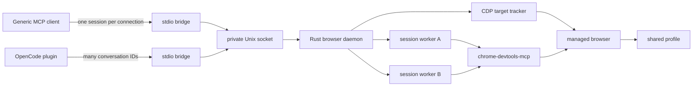

# opencode-browser-mcp

[](https://www.npmjs.com/package/@mirsella/opencode-browser-mcp)
[](https://github.com/mirsella/opencode-browser-mcp/actions/workflows/ci.yml)
[](LICENSE)

**One browser profile. Separate tab ownership for every MCP session.**

This package is a local browser broker built around
[`chrome-devtools-mcp`](https://github.com/ChromeDevTools/chrome-devtools-mcp).
Concurrent agents share one managed Chromium-family browser and its signed-in
profile, while a Rust daemon assigns each CDP tab to exactly one session.

It works as a standard stdio MCP server. The bundled OpenCode plugin adds a
stronger integration that multiplexes many OpenCode conversations through the
same MCP connection without exposing routing details to the model.

The MCP daemon answers compact OpenCode initialization without starting its
downstream worker or opening Chromium. Compact help, direct tool listing, or the
first browser action initializes the tool catalog on demand. The first browser
action then starts the managed browser and restores any matching ownership state.

Tab control is isolated. Browser data is shared. See [security model](#security-model)
before using a profile that contains sensitive accounts.

## Why this exists

| Setup | Result |
| --- | --- |
| One DevTools MCP server shared by every agent | Agents share current-page state and can collide with each other |
| One browser per agent | Clean isolation, but every agent needs another browser and another login |
| This project | One browser and profile, with daemon-enforced tab ownership per session |

The daemon does not infer ownership from whichever page happens to be selected.
It creates tabs through CDP, records the exact stable target ID, and treats that
record as the authority for routing and cleanup.

## Requirements

- Linux x64
- Bun for the default `chrome-devtools-mcp` worker launcher
- Node.js 20.19+, 22.12+, or 23+ when installing or running through npm
- A compatible local Chromium-family browser
- A graphical display server; headless mode is not supported
- An MCP host, or OpenCode 1.18+ for the bundled plugin
- `XDG_RUNTIME_DIR` for the default daemon socket, unless a custom socket is configured

## Installation

The canonical npm package is `@mirsella/opencode-browser-mcp`. It includes the
OpenCode plugin, browser skill, JavaScript launcher, and Linux x64 native binary.
OpenCode users normally install it by adding the package to `opencode.json` as
shown below; OpenCode resolves the npm package on restart.

To run the npm CLI without installing it globally:

```sh
npx -y @mirsella/opencode-browser-mcp --help
```

Or install the CLI globally:

```sh
npm install --global @mirsella/opencode-browser-mcp
opencode-browser-mcp --help
```

The Cargo package and binary are both named `opencode-browser-mcp`. The crate is
not currently published on crates.io; install the native MCP server from GitHub:

```sh
cargo install --git https://github.com/mirsella/opencode-browser-mcp.git --locked opencode-browser-mcp
```

The Cargo installation contains only the native generic MCP server. Use the npm
package for the OpenCode plugin, compact tools, skill, and session lifecycle
hooks.

To build a source checkout:

```sh
git clone https://github.com/mirsella/opencode-browser-mcp.git
cd opencode-browser-mcp
bun install
cargo build --release
./target/release/opencode-browser-mcp --help
```

For local OpenCode plugin development, reference the checkout directly after
building it:

```json
{
  "$schema": "https://opencode.ai/config.json",
  "plugin": [
    "file:///absolute/path/to/opencode-browser-mcp/plugin/browser-routing.ts"
  ]
}
```

## OpenCode setup

Add the npm package to `opencode.json`:

```json
{
  "$schema": "https://opencode.ai/config.json",
  "plugin": ["@mirsella/opencode-browser-mcp"]
}
```

Restart OpenCode after changing the configuration. The plugin:

- registers the local `browser` MCP server;
- advertises one short browser skill and loads its instructions only when needed;
- injects the active OpenCode session ID after model argument generation;
- releases the session's owned tabs when the agent turn ends or the session is deleted.

The routing field is absent from every tool schema, so models do not need to
know about it or spend output tokens supplying it.

### Compact tools

OpenCode sees only two small browser tool definitions by default:

- `browser_dispatch` executes any available browser action.
- `browser_help` lists action names or loads the current schema for one action.

The complete Chrome DevTools schemas are therefore absent from ordinary turns.
When browser automation is needed, the agent loads the short skill and requests
only the action definitions it needs. Generic MCP clients continue to receive
the full direct tool surface.

Compact mode uses `browser_dispatch` as its OpenCode permission boundary. If
the plugin detects existing per-action `browser_*` permission or tool rules, it
automatically falls back to direct tools so those rules keep working. Set
`compactTools: false` explicitly when policies are generated by another plugin
or otherwise unavailable during configuration.

To expose every direct `browser_*` tool in OpenCode instead:

```json
{
  "$schema": "https://opencode.ai/config.json",
  "plugin": [
    ["@mirsella/opencode-browser-mcp", { "compactTools": false }]
  ]
}
```

To keep browser tabs between turns, disable completion cleanup and rely on the
daemon's idle timeout instead:

```json
{
  "$schema": "https://opencode.ai/config.json",
  "plugin": [
    ["@mirsella/opencode-browser-mcp", { "releaseOnIdle": false }]
  ]
}
```

To give each active OpenCode session its own top-level browser window for visual
organization, opt into `window-per-session`. This commonly pairs with retained
tabs so the window stays available between turns:

```json
{
  "$schema": "https://opencode.ai/config.json",
  "plugin": [
    [
      "@mirsella/opencode-browser-mcp",
      { "sessionLayout": "window-per-session", "releaseOnIdle": false }
    ]
  ]
}
```

`sessionLayout` defaults to `shared-window`. Window placement is best effort:
the first broker-created tab requests a new window, and later tabs are created
after activating one of that session's owned tabs. Chromium does not expose an
atomic "create in window ID" operation, so manual tab moves, site-created
popups, or other browser activity can change the visual grouping. The broker
never moves or closes a tab merely to repair window placement.

OpenCode 1.18 or newer is required.

## Generic MCP setup

Run the package as a normal stdio MCP server:

```sh
npx -y @mirsella/opencode-browser-mcp
```

Generic MCP clients can also opt into separate visual windows per connection:

```sh
npx -y @mirsella/opencode-browser-mcp --session-layout window-per-session
```

For hosts that use JSON configuration, the equivalent shape is:

```json
{
  "mcpServers": {
    "browser": {
      "command": "npx",
      "args": ["-y", "@mirsella/opencode-browser-mcp"]
    }
  }
}
```

After a global npm or Cargo installation, configure the installed binary
directly instead:

```json
{
  "mcpServers": {
    "browser": {
      "command": "opencode-browser-mcp"
    }
  }
}
```

Each stdio connection gets its own browser session. Calls on that connection
see only its owned tabs. When the connection closes, the daemon closes those
tabs and leaves tabs owned by other connections alone.

Generic clients must not set `__opencode_session_id`. That field belongs to the
OpenCode adapter and is rejected on ordinary MCP connections.

## Architecture



Each active browser session leases its own `chrome-devtools-mcp` worker.
Reusable workers are kept in a bounded, workspace-keyed warm pool to avoid
browser-level CDP reconnect churn and are health-checked before each lease.
The compact two-tool surface is available before the downstream worker starts.
Direct tool listing, compact help, and the first action trigger one daemon-owned
tool discovery task and await its cached result. None of these operations opens
the browser; Chromium still starts only for an actual browser action.
Worker-local numeric page IDs never cross session boundaries. The daemon maps
them to stable browser-level CDP tab targets and removes page selection tools
from the public surface.

Ownership state is written atomically beside the daemon socket. If the daemon
crashes while the browser survives, it restores ownership only when the exact
browser WebSocket generation and live tab targets still match.

## Ownership guarantees

- A tab has at most one owner.
- Sessions run concurrently through separate downstream workers.
- Popups inherit the owner of their opener tab.
- Optional per-session windows are visual organization only; target ownership remains the routing authority.
- A session cannot select, inspect, or close another session's tabs through this MCP server.
- Manual and otherwise unowned tabs are never claimed during session cleanup.
- Stale browser generations, malformed worker responses, ownership conflicts, and tracker disconnects fail closed.
- Reusing one routed session ID from another workspace is rejected.
- `pageId`, `select_page`, and the OpenCode routing field are not exposed to models.

These are routing guarantees, not an operating-system security boundary. Any
local process that connects directly to the CDP port bypasses the broker.

## Browser compatibility

The managed browser must be a Chromium-family browser with a Chrome-compatible
browser-level CDP endpoint. In particular, this project relies on Chromium's
`Target` discovery, flat sessions, tab targets, opener lineage, and
`Target.createTarget` with `forTab`. Per-session window layout additionally uses
`Target.createTarget` with `newWindow`, `Target.activateTarget`, and
`Browser.getWindowForTarget`.

Google Chrome and Chrome for Testing are the browsers officially supported by
the pinned `chrome-devtools-mcp@1.6.0`. The launcher also detects Helium,
Chromium, Brave, and Microsoft Edge. Those browsers are best-effort because
their CDP behavior is not guaranteed by the upstream MCP project.

Use any compatible local executable explicitly:

```sh
OPENCODE_BROWSER_EXECUTABLE=/path/to/browser \
OPENCODE_BROWSER_PROFILE=/path/to/user-data-dir \
npx -y @mirsella/opencode-browser-mcp
```

The executable must accept Chromium command-line flags. The profile value is a
full user-data directory, not a named profile such as `Default`.

Chrome 136 and newer ignore remote-debugging flags for Chrome's default data
directory. For Google Chrome and Chrome for Testing, the default user-data
directory is `$XDG_CONFIG_HOME/opencode-browser-mcp/google-chrome`, or
`~/.config/opencode-browser-mcp/google-chrome` when `XDG_CONFIG_HOME` is unset.
Set `OPENCODE_BROWSER_PROFILE` to another non-default directory if you want a
previously signed-in profile. The current release manages a loopback CDP
endpoint; attaching to an arbitrary existing or remote endpoint is not
supported.

## Lifecycle

| Event | Behavior |
| --- | --- |
| MCP initializes, lists tools, or loads compact help | The daemon responds without starting Chromium |
| First browser action | The managed browser and CDP ownership tracker start lazily |
| Generic MCP connection closes | Its owned tabs and worker lease are released |
| OpenCode turn becomes idle | Its owned tabs are released by default |
| OpenCode session is deleted | Its owned tabs are released |
| Release arrives during an active call | Cleanup is queued and runs after active work completes |
| Session exceeds the idle timeout | The daemon retries cleanup as a fallback |
| Last MCP stdio bridge disconnects | After two seconds, the daemon closes the managed browser and clears ownership |
| Daemon crashes but browser survives | Matching generation state is recovered conservatively |

`releaseOnIdle: false` keeps OpenCode tabs alive between turns. The default
daemon idle timeout is 60 minutes.

Closing a TUI attached to a long-lived OpenCode server does not necessarily
close the server's shared MCP bridge. OpenCode currently exposes no plugin event
for an individual attached client disconnect, so use turn-idle cleanup, session
deletion, or the daemon idle timeout for per-session cleanup.

## Configuration

| Environment variable | Default | Purpose |
| --- | --- | --- |
| `OPENCODE_BROWSER_EXECUTABLE` | auto-detected | Chromium-family browser executable |
| `OPENCODE_BROWSER_PROFILE` | browser-dependent; see Browser compatibility | Shared browser data directory |
| `OPENCODE_BROWSER_SOCKET` | `$XDG_RUNTIME_DIR/opencode-browser-mcp/daemon.sock` | Private daemon socket |
| `OPENCODE_BROWSER_SESSION_LAYOUT` | `shared-window` | `shared-window` or best-effort `window-per-session` organization |
| `OPENCODE_BROWSER_CDP_HOST` | `127.0.0.1` | CDP host; loopback only |
| `OPENCODE_BROWSER_CDP_PORT` | `9222` | CDP port |
| `OPENCODE_BROWSER_IDLE_MINUTES` | `60` | Fallback session cleanup; `0` disables expiry |
| `OPENCODE_BROWSER_STARTUP_SECONDS` | `20` | Browser startup deadline |
| `OPENCODE_BROWSER_OPERATION_SECONDS` | `540` | Browser operation deadline |
| `OPENCODE_BROWSER_DOWNSTREAM_COMMAND` | `bunx` | `chrome-devtools-mcp` launcher |
| `OPENCODE_BROWSER_DISABLE_CRASH_REPORTER` | `false` | Disable Chromium crash reporting |
| `RUST_LOG` | `opencode_browser_mcp=info` | Native daemon log filter |

The first client starts the daemon and fixes these values for its lifetime, but
Chromium remains stopped until a browser action needs it. Later clients with a
different daemon configuration are rejected.

The default socket directory is created under `XDG_RUNTIME_DIR` with mode
`0700`. A custom socket path does not create its parent; the parent must already
exist, be owned by the current user, and have no group or other permissions. The
browser profile must satisfy the same ownership and privacy requirements.

For a socket path `<socket>`, runtime files are:

```text
<socket>
<socket>.lock
<socket>.state.json
<socket>.stderr.log
```

The browser profile also contains `opencode-browser-mcp.lock`. Environment
overrides must be exported to the OpenCode process so the plugin and MCP server
inherit them.

CLI controls:

```sh
opencode-browser-mcp --help
opencode-browser-mcp --version
opencode-browser-mcp --stop-daemon
```

The routing modes are `connection` for generic MCP clients, `opencode` for the
compact OpenCode interface, and `opencode-direct` for OpenCode with every direct
tool exposed. The plugin selects the appropriate OpenCode mode automatically.

### Troubleshooting

- If `XDG_RUNTIME_DIR` is unavailable, set `OPENCODE_BROWSER_SOCKET` to a socket
  inside an existing private directory.
- Permission errors for the socket or profile mean the path is not owned by the
  current user or permits group/other access. Restrict the directory to `0700`.
- A process already listening on the configured CDP port must belong to the
  exact managed browser generation. Stop it or choose another
  `OPENCODE_BROWSER_CDP_PORT`; arbitrary existing CDP endpoints are rejected.
- A profile-lock error means another daemon is already using that profile.
- Browser startup and daemon errors are written to `<socket>.stderr.log`.
- If `chrome-devtools-mcp` cannot start, verify that `bunx` is available or set
  `OPENCODE_BROWSER_DOWNSTREAM_COMMAND` to a compatible launcher, then restart
  the OpenCode MCP connection; catalog initialization errors are cached for the
  daemon lifetime.
- The plugin refuses to replace an unrelated `mcp.browser` entry. Remove or
  rename that MCP configuration before enabling this package.

## Security model

The broker protects tab ownership only for clients that use its MCP interface.

| Protected by the broker | Shared by design | Outside the boundary |
| --- | --- | --- |
| Tab visibility, selection, and cleanup | Cookies, logins, storage, extensions, cache, permissions, and downloads | Direct access to the loopback CDP port |
| Worker-local page selection state | Browser process and profile | Other processes running as the same user |
| Generation-scoped ownership recovery | Network and website content | Prompt injection from pages |
| Private daemon socket and state files | Workspace access granted to the MCP host | OS, container, or VM isolation |

The downstream worker disables usage statistics and CrUX field-data requests.
It also disables update checks and redacts headers that upstream classifies as
sensitive. URLs, bodies, and other headers can still appear in tool output.

Read [`SECURITY.md`](SECURITY.md) before using a profile with sensitive data.

## Limitations

- The published native binary supports Linux x64 only.
- Browser windows are headed; there is no headless option yet.
- Browser profile data is shared between sessions.
- The CDP endpoint is unauthenticated loopback TCP.
- Browser content is untrusted input and can contain prompt injection.
- The target ownership model requires Chromium-specific CDP behavior.
- Browser tools rely on experimental interfaces from `chrome-devtools-mcp@1.6.0`.
- `isolatedContext` is intentionally disabled because it conflicts with shared-profile ownership.
- A fresh existing CDP endpoint and remote CDP endpoints are not supported.

## Development

```sh
cargo fmt --check
cargo test --all-targets
cargo clippy --all-targets -- -D warnings
bun test tests/plugin.test.ts
cargo test --release --test e2e -- --ignored --nocapture
```

The headed E2E test uses a temporary profile and CDP port. Building the npm
artifact requires Rust 1.89 or newer and the musl target:

```sh
rustup target add x86_64-unknown-linux-musl
npm pack
```

| Path | Responsibility |
| --- | --- |
| `plugin/` | OpenCode routing and lifecycle adapter |
| `bin/` | npm launcher for the native binary |
| `src/daemon.rs` | stdio bridges, Unix socket daemon, connection routing, and controls |
| `src/cdp.rs` | stable CDP target tracking and ownership |
| `src/main.rs` | browser supervision, session workers, and response filtering |
| `src/persistence.rs` | atomic generation-scoped ownership state |
| `tests/e2e.rs` | real-browser isolation and cleanup coverage |

See [`CONTRIBUTING.md`](CONTRIBUTING.md) for the development and release
workflow.

## License

[MIT](LICENSE)
